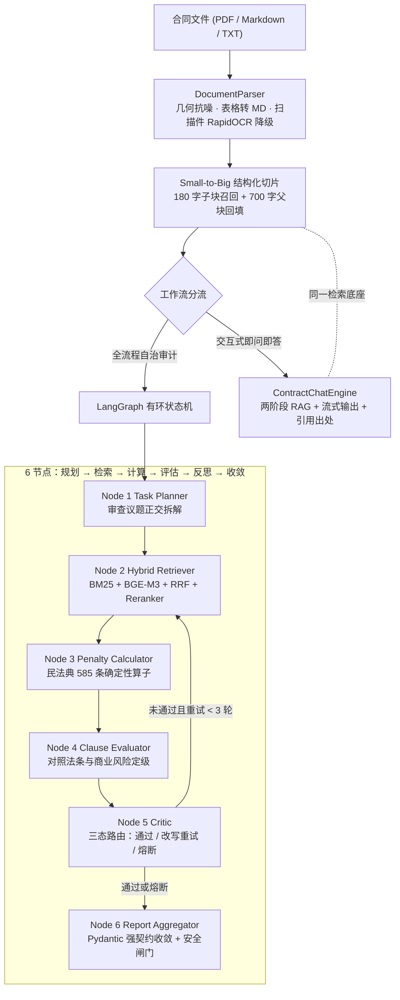

# DocuMind-Agent

**面向长篇合同的合规审查智能体：每一条结论都必须钉回原文的页码与行号；钉不住，就拒绝下结论。**

[](https://www.python.org/)
[](https://github.com/langchain-ai/langgraph)
[](https://docs.pydantic.dev/)
[](LICENSE)

---

## 它解决的不是"能不能答"，而是"敢不敢信"

用通用 RAG 审合同，通常会在三处失守，而且失守时**看起来一切正常**：

| 失效点 | 现场表现 | 业务后果 |
| --- | --- | --- |
| **坐标脑补** | 报告写"第 7 条，第 120–135 行"，回原文却对不上 | 法务无法逐条复核，整份报告作废 |
| **数值幻觉** | 违约金比例、累计上限被"算"出一个像样的数字 | 谈判桌上引用错误数字，真金白银的损失 |
| **假性闭环** | 检索根本没召回，模型仍给出"已核实"的结论 | 风险被静默漏掉，比不审更危险 |

DocuMind 的每一个机制都针对这三件事：**坐标可反查、数值交给确定性算子、未闭环就熔断**。

## 10 秒看懂

- **输入**：PDF（含纯图片扫描件）/ Markdown / 纯文本合同，长篇多条款
- **输出**：结构化风险清单（定级 + 原文证据 + 页码/行号 + 修改建议 + 可直接替换的条款文本），可一键导出 Markdown 审查报告
- **双工作流**：`全流程自治审计`（LangGraph 有环状态机，出报告）+ `即问即答 Copilot`（同一检索底座，流式回答并给出引用出处）
- **保底承诺**：任何一条结论只要无法在原文物理闭环，就会被标为 `unverified_needs_human_review`，且整篇综合定级**不会被评成"低风险"**
- **可复现的检索收益**：8 条高危条款黄金集上，混合召回把 `Hit@1` 从 87.5% 提到 100%（[评测方法与局限](#量化验证检索到底提升了多少)）

### 输出长什么样

> 结构示意，字段由 `src/schemas.py` 的 Pydantic v2 契约强校验，非法/缺失字段无法落库。

```json
{
  "issue_id": "RISK-FIN-01",
  "title": "单方违约金比例超出司法保护上限",
  "risk_level": "高风险",
  "category": "财务风控",
  "evidence": {
    "clause_title": "第7条 违约责任",
    "original_text": "……每逾期一日，按合同总额的 1.5% 向甲方支付违约金……",
    "page_number": 6,
    "line_start": 214,
    "line_end": 217,
    "verification_status": "verified"
  },
  "risk_analysis": "……",
  "suggestion": "……",
  "suggested_replacement": "……"
}
```

`evidence.verification_status` 默认值是 `UNVERIFIED`（Fail-Closed），只有反查命中原文才会被显式放行为 `verified`。

---

## 三个核心机制

### 1. 证据链绑定在解析期，而不是事后字符串查找

- 解析器产出带真实页码与物理行号的 `ParsedSection`（`page_start/page_end/line_start/line_end`），检索切片与这些结构体**物理绑定**；反查定位不再依赖 `text.find()` 这类"看起来对"的手段。
- 反查结果必须满足 **Δ = 0**：`tests/test_evidence_anchor.py` 对万字样本合同的前 12 个章节逐条断言 `反查行号 − 真实起始行号 == 0`。
- **伪造证据必须被拦下**：同一测试注入一段编造的条款，要求返回 `unlocated` + `UNVERIFIED`，而不是"长得像就放行"。
- 真实 PDF 保留物理页码，不会出现 `第 None - None 行` 这类报表事故。

### 2. 会认错的闭环：三态路由 + 3 轮熔断 + 报表闸门

LangGraph 状态机里，`critic` 节点是唯一的决策岔口，路由结果只有三种，没有"默认通过"：

| 状态 | 触发条件 | 系统行为 |
| --- | --- | --- |
| `verified` | 结论在原文 100% 命中且坐标对齐 | 放行，推进下一议题 |
| `unverified_needs_human_review` | 连续 3 轮 Query 改写仍无法闭环 | **熔断**，显式标记需人工核验，拒绝伪造可信度 |
| `infra_degraded` | 精排/基础设施故障而非内容造假 | 与"模型编造"解耦，**不触发无意义的 3 轮重试** |

同时有一道**报表级安全闸门**：只要 `unverified_count > 0`，综合定级强制不低于"中风险"，并且 `needs_human_review = true`。系统的"不知道"会一路传到报告的顶层字段，而不是消失在某一层日志里。

### 3. 确定性风控算子：该算的绝不交给 LLM

- 违约金风险由 `src/tools/compliance_tools.py` 的数学算子计算，依据《民法典》第 585 条与最高法《合同编通则解释》第 65 条，以**实际损失**为司法调减的参照基准（超过损失 30% 可请求调减）；合同额占比只作为**商业预警指标**呈现，不冒充法律结论。
- 参数抽取 Prompt 允许返回 `null`：要素缺失时算子返回 `status="incomplete_data"`，提示线下核验，**不用默认值把空缺填成一个"合理"的数字**。

### 4. 支撑：可量化的两阶段混合检索

- **Small-to-Big**：180 字子块负责精准召回，命中后回填 700 字父块补足上下文与免责前提。
- **四模式漏斗**：`pure_vector` / `pure_bm25` / `hybrid_rrf`（RRF，k=60）/ `hybrid_rerank`（BGE-Reranker-v2-m3 交叉精排），精排前把候选池扩到 40 条，给 Cross-Encoder 足够的重排空间。
- **磁盘级 MD5 缓存**：同一文件内容哈希可复用索引与 OCR 结果，跳过重复 Embedding 与转录开销。

---

## 架构



`critic` 的循环边是本项目与"一次性 Prompt 流水线"的实质区别：不闭环就重查，重查不行就熔断，而不是把重试次数藏起来。

---

## 量化验证：检索到底提升了多少

不做"我们用了 RAG"式的自证。仓库自带消融实验，对比三种配置在同一份万字合同、同一套 8 类高危法务陷阱黄金集上的表现：

```bash
python tests/eval_benchmark.py
```

输出 `Hit@1`、`Hit@3`、`NDCG@3`、`MRR` 四项指标的对比榜单。本机实测结果（合同样本：`tests/sample_contracts/large_scale_procurement_contract.md`）：

| 配置 | Hit@1 | Hit@3 | NDCG@3 | MRR | 相对 baseline |
| --- | --- | --- | --- | --- | --- |
| 纯向量检索（baseline） | 87.5% | 100.0% | 0.9539 | 0.9375 | — |
| BM25 + Vector + RRF | **100.0%** | 100.0% | **1.0000** | **1.0000** | Hit@1 **+12.5pt**，NDCG@3 +0.0461，MRR +0.0625 |
| + BGE-Reranker 精排 | 100.0% | 100.0% | 1.0000 | 1.0000 | 与 RRF 持平（本集已饱和） |

两点必须说清楚，否则这张表会被误读：

1. **提升来自"混合召回"，不是"精排"**。纯向量把 8 题中的 1 题排到了第 2 位，BM25 + 向量的 RRF 把它拉回第 1 位；精排层在这套题上没有增量，因为 RRF 已经 8/8 命中、不存在可优化的排序空间。
2. **8 条黄金集已经饱和**，只能证明"混合召回消除了 baseline 的首位漏检"，不足以证明精排在长合同、近似条款干扰下的价值。要验证精排层，需要扩充更难、更大的对抗性测试集——这是当前评测明确的短板。

> 上表数据由 `python tests/eval_benchmark.py` 实测得到，可复现；请勿在此基础上外推"线上召回率"。

---

## 快速开始

### 第 0 步：不联网、不配密钥，先看核心逻辑对不对（约 1 分钟）

```bash
python training/practice_exam.py
```

该脚本用纯 Python 重实现并断言了三个关键算子：RRF 倒数排名融合、Small-to-Big 拓扑去重、Critic 事实核查状态机（含防死循环）。**不调用任何模型 API**。

### 第 1 步：安装依赖

```bash
python -m venv .venv
# Windows PowerShell:
.\.venv\Scripts\Activate.ps1
# Linux / macOS:
source .venv/bin/activate

pip install -r requirements.txt
```

### 第 2 步：配置模型与 Embedding

```bash
cp .env.example .env
```

```ini
OPENAI_API_KEY=sk-xxxx
OPENAI_BASE_URL=https://api.siliconflow.cn/v1
MODEL_NAME=deepseek-ai/DeepSeek-V3
```

任选其一：OpenAI 兼容接口（默认走硅基流动，也可换 DeepSeek / Kimi / 智谱），或配置 `GEMINI_API_KEY` 走 Google 原生 SDK。注意：Embedding 使用 `BAAI/bge-m3`，同样通过该接口调用，**没有密钥时检索链路不可用**。

### 第 3 步：启动

```bash
# 交互式工作台（审计大报告 + Copilot 问答）
streamlit run app.py

# 或：FastAPI 异步微服务
uvicorn src.api:app --host 0.0.0.0 --port 8000
```

### 第 4 步：跑测试

```bash
python tests/test_evidence_anchor.py   # 证据链 Δ=0 + 虚假证据拦截
python tests/test_pdf_parser.py        # PDF 版面清洗 / 页码 / 表格还原
python tests/test_api.py               # 微服务端点与上传链路
```

> 前两个测试会实例化检索引擎，需要 `.env` 中的 Embedding 密钥。

---

## HTTP API

| 方法 | 路径 | 说明 |
| --- | --- | --- |
| `GET` | `/health`、`/api/v1/health` | 健康探针，返回可用特性列表 |
| `POST` | `/api/v1/audit/upload` | 上传并解析文档，返回章节结构与页码/行号 |
| `POST` | `/api/v1/audit/sync` | 同步审查，返回 `ContractAuditReport` 强类型 JSON |
| `POST` | `/api/v1/audit/stream` | SSE 流式输出状态机事件，可看到每个节点的推进过程 |

启动后访问 `http://localhost:8000/docs` 查看 Swagger。

---

## 目录结构

```text
DocuMind-Agent/
├── app.py                      # Streamlit 双工作台（审计报告 / Copilot）
├── src/
│   ├── api.py                  # FastAPI 端点（含 SSE 状态机事件流）
│   ├── graph_agent.py          # LangGraph 6 节点有环状态机 + 调度外观
│   ├── agent.py                # 独立 ReAct 智能体形态（多工具自主调度）
│   ├── chat_engine.py          # 流式问答引擎（复用同一检索底座）
│   ├── parser.py               # PDF/MD 解析、表格还原、OCR 降级与缓存
│   ├── schemas.py              # Pydantic v2 契约（Fail-Closed 状态机）
│   ├── config.py               # OpenAI 兼容 / Gemini 双通道配置
│   ├── rag/
│   │   ├── hybrid_retriever.py # BM25 + 向量 + RRF + Reranker 两阶段检索引擎
│   │   ├── chunking.py         # Small-to-Big 父子块切片
│   │   └── reranker.py         # BGE-Reranker 精排客户端
│   └── tools/
│       └── compliance_tools.py # 违约金确定性算子 + 检索工具工厂
├── tests/
│   ├── test_evidence_anchor.py # 证据 Δ=0 与安全闸门断言
│   ├── test_pdf_parser.py      # PDF 版面与页码测试
│   ├── test_api.py             # 微服务端点测试
│   ├── eval_benchmark.py       # 三配置检索消融实验（Hit@k / NDCG / MRR）
│   ├── generate_long_pdf.py    # 长篇测试合同生成器
│   └── sample_contracts/       # 真实涉诉合同、万字框架协议、扫描件样本
├── training/                   # 核心算子手撕练习与免密钥自测
├── docs/DEBUG_GUIDE.md         # VS Code 运行与单步调试指南
└── Dockerfile / docker-compose.yml
```

---

## 适用边界与已知局限

- **语言与法域**：围绕中文合同与《民法典》合同编构建，法条库聚焦违约金、违约责任、验收、知识产权与保密等常见条款，不覆盖全部监管领域。
- **不替代律师**：系统输出是"带证据的审查线索"，最终判断仍需法务确认；`needs_human_review` 为 `true` 时尤其如此。
- **OCR 的边界**：仅在检测到纯图片 PDF 时降级到 RapidOCR，默认最多 50 页（`_parse_pdf_with_ocr(max_pages=50)`）；扫描质量差时识别率会显著下降。
- **依赖外部模型**：Embedding 与生成均走外部 API，网络或配额异常会触发 `infra_degraded`，此时检索置信度不可比。
- **评测规模有限**：黄金集 8 条，属于回归级验证，不足以支撑"通用准确率"结论。

## 许可证

[MIT](LICENSE)。

法条引用依据：《中华人民共和国民法典》第 585 条；最高人民法院《关于适用〈民法典〉合同编通则若干问题的解释》第 65 条。
