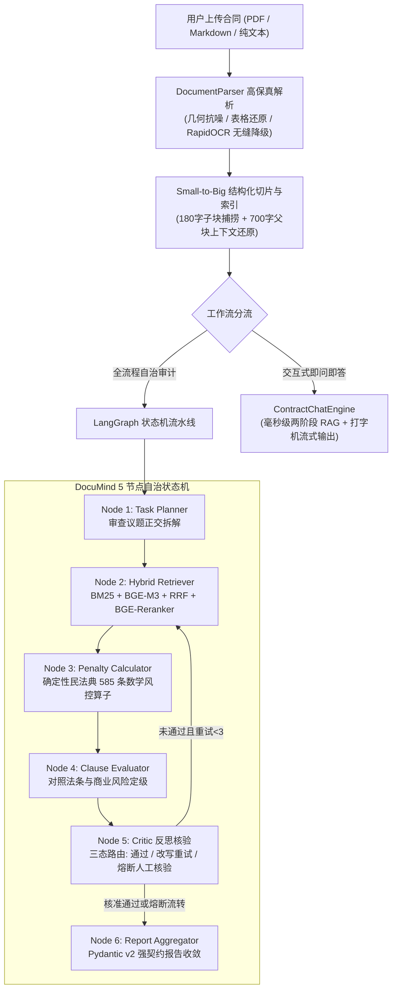

# DocuMind-Agent: 工业级合同合规审查与证据链溯源智能体系统

[](https://www.python.org/)
[](https://fastapi.tiangolo.com/)
[](https://github.com/langchain-ai/langgraph)
[](https://www.trychroma.com/)
[](https://opensource.org/licenses/MIT)

> 面向企业长篇复杂合同（采购框架协议、技术服务外包、法律涉诉文本、扫描件 PDF）的**高保真合规审查、证据链物理对齐与风险熔断智能体系统**。
> 采用 **LangGraph 有向有环状态机** + **Small-to-Big 两阶段混合检索引擎** + **确定性风控数学算子**，彻底解决 LLM 在长文合规审查中的“坐标脑补、计算幻觉、假性闭环”三大顽疾。

---

## 🌟 核心架构与系统流转



---

## 🚀 核心工业级特性亮点

### 1. 证据链绝对物理坐标系（消灭行号漂移）
- **源头绑定**：抛弃事后字符串查找的伪坐标，检索引擎与解析期产出的 `ParsedSection` 结构体物理绑定；
- **0 偏差对齐**：反查坐标严格满足 $\Delta = 0$（经 [`tests/test_evidence_anchor.py`](tests/test_evidence_anchor.py) 自动化全量回归断言）；
- **真实 PDF 页码**：完整保留物理页码信息，杜绝硬编码假页码与 `第 None - None 行` 异常。

### 2. Fail-Closed 闭环安全机制与三态路由
- **默认不可信**：`verification_status` 枚举默认值为 `UNVERIFIED`（Fail-Closed）；
- **三态路由设计**：
  - `VERIFIED`：条款 100% 存在且物理坐标精准对齐；
  - `UNVERIFIED_NEEDS_HUMAN_REVIEW`：连续 3 轮改写仍未闭环证据链时触发**熔断通道**，系统拒绝伪造可信度，显式打标提示法务人工核验；
  - `INFRA_DEGRADED`：清晰解耦“基础设施精排故障”与“内容模型造假”，降级时避免无意义的无效重试；
- **报表级安全闸门**：若全篇合同存在未闭环证据项，综合定级**坚决不评为低风险（至少为中风险）**，确保风控审慎边界。

### 3. 确定性风控算子（输入侧与法律依据修正）
- **拒绝虚假默认值**：参数抽取 Prompt 允许 `null`，要素缺失时返回 `status="incomplete_data"` 提示法务线下核验；
- **准确法律指引**：依据《民法典》第 585 条及最高法《合同编通则解释》第 65 条，明确澄清司法调减的法定参照基准为**“实际损失”**（超过损失 30% 可申请调减），将合同额占比准确界定为商业预警指标。

### 4. 完整的两阶段四模式混合检索漏斗
- **多路召回与重排**：支持 `pure_vector`、`pure_bm25`、`hybrid_rrf`（倒数排名融合，平滑常数 $k=60$）、`hybrid_rerank`（BGE-Reranker-v2-m3 交叉精排）；
- **动态扩大候选**：初筛候选集扩大至 40 个，给 Cross-Encoder 充足的精排重排序空间；
- **磁盘级 MD5 缓存**：支持同一文件内容哈希秒级复用，跳过重复 Embedding 与分块开销。

---

## 📁 项目目录结构

```text
DocuMind-Agent/
├── app.py                      # Streamlit 双工作台 (审计大报告 vs 即问即答 Copilot)
├── requirements.txt            # 项目依赖清单 (含 langgraph, reportlab, pytest)
├── Dockerfile                  # 容器化部署文件
├── docker-compose.yml          # 多服务编排配置
├── .env.example                # 环境变量配置模板
├── src/
│   ├── api.py                  # FastAPI 异步微服务端点 (支持 SSE 状态机事件流)
│   ├── graph_agent.py          # LangGraph 5 节点自治状态机与审查智能体
│   ├── chat_engine.py          # 毫秒级流式问答 Copilot 引擎
│   ├── parser.py               # 文档解析器 (PDF / Markdown / RapidOCR 智能缝合)
│   ├── schemas.py              # Pydantic v2 强契约数据模型 (Fail-Closed 状态机)
│   ├── rag/
│   │   ├── hybrid_retriever.py # 两阶段持久化混合检索引擎 (RRF + Rerank)
│   │   ├── chunking.py         # Small-to-Big 父子块切片器
│   │   └── reranker.py         # BGE-Reranker 交叉注意力精排客户端
│   └── tools/
│       └── compliance_tools.py # 确定性违约金风控数学算子与检索工具工厂
├── tests/
│   ├── test_evidence_anchor.py # 证据链 0 漂移与安全闸门自动化断言测试
│   ├── test_api.py             # FastAPI 微服务端点自动化测试
│   ├── test_pdf_parser.py      # PDF 解析与版面清洗测试
│   └── sample_contracts/       # 真实涉诉与企业长篇合同样本集
├── training/                   # 核心算法手撕攻坚卷与自测用例
│   ├── practice_exam.py        # RRF 融合、Small-to-Big 拓扑去重、Critic 状态机手撕自测
│   ├── practice_langgraph.py   # LangGraph 状态机编排练习卷
│   └── README.md               # 练习集规范说明
└── docs/
    └── DEBUG_GUIDE.md          # VS Code 单步断点调试实战指南
```

---

## ⚡ 快速开始

### 1. 环境准备与依赖安装
建议使用 Python 3.10 ~ 3.12 虚拟环境：

```bash
# 克隆仓库
git clone https://github.com/YOUR_USERNAME/DocuMind-Agent.git
cd DocuMind-Agent

# 创建并激活虚拟环境
python -m venv .venv
# Windows PowerShell:
.\.venv\Scripts\Activate.ps1
# Linux / macOS:
source .venv/bin/activate

# 安装生产级依赖
pip install -r requirements.txt
```

### 2. 环境变量配置
复制 `.env.example` 为 `.env` 并填入大模型与 Embedding API 密钥：

```bash
cp .env.example .env
```

配置示例：
```ini
OPENAI_API_KEY=sk-xxxx你的硅基流动或OpenAI密钥xxxx
OPENAI_BASE_URL=https://api.siliconflow.cn/v1
MODEL_NAME=deepseek-ai/DeepSeek-V3
```

### 3. 启动交互式 Web 工作台
```bash
streamlit run app.py
```
浏览器打开 `http://localhost:8501` 即可体验双工作流（全流程审计大报告 + 毫秒级 Copilot 问答）。

### 4. 启动 FastAPI 异步微服务
```bash
uvicorn src.api:app --host 0.0.0.0 --port 8000 --reload
```
访问 Swagger 交互文档：`http://localhost:8000/docs`。

---

## 🧪 自动化测试套件

运行全套核心测试，验证系统 0 误差物理证据锚定与微服务健康探针：

```bash
# 1. 运行证据链 0 漂移与 Fail-Closed 安全闸门断言测试
python tests/test_evidence_anchor.py

# 2. 运行 FastAPI 微服务全链路测试
python tests/test_api.py

# 3. 运行底层三大算法算子手写单测自检
python training/practice_exam.py
```

---

## 📄 开源许可证
本项目遵循 [MIT License](LICENSE)。
