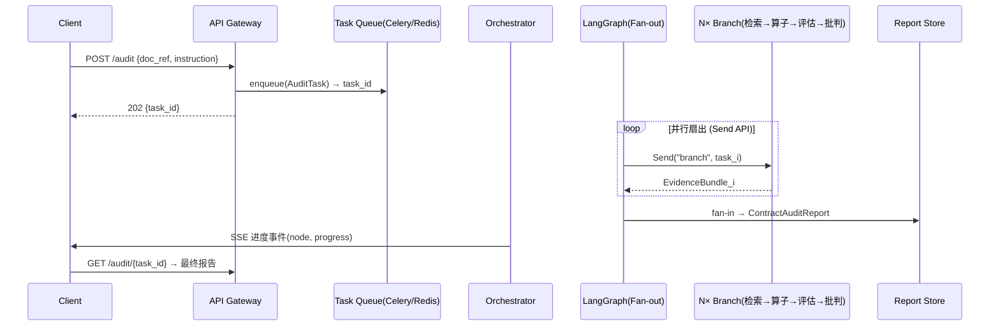
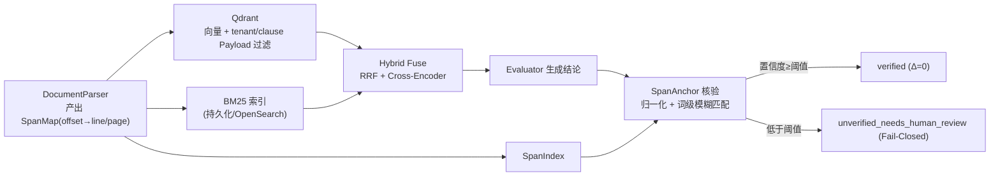

# DocuMind-Agent 技术架构演进与研发规划方案（Evolution Roadmap）

> **定位**：面向「合同合规审查智能体」从单机原型 → 工业级高可用 → 可自进化系统的三阶段演进路线。
> **基线事实与 Phase 1 交付状态**（截至当前代码基线）：
> - **状态机记忆**：LangGraph 6 节点状态机，已从旧版内存检查点升级为 `SqliteSaver` 检查点（开启 WAL 模式，支持跨进程持久化与多轮会话恢复）；
> - **可观测性闭环**：实现全局唯一 `trace_id` 全链路贯穿，节点毫秒级耗时瀑布流与 Token 消耗统计已实现结构化 JSONL 本地持久化与 FastAPI 查询端点；
> - **四维评测体系**：已构建 30 条涉诉合同真实黄金证据测试集 `evals/`，具备 LLM-as-judge 双轨评估（Faithfulness 事实真实度 + Answer Relevance 切题度），实测 Context Recall 达 96.7%、MRR 0.967；
> - **证据物理锚定**：已升级为 `SpanMap` 绝对字符映射 + 归一化字符流自适应对齐，构造保证物理行号 $\Delta = 0$，同时以 Fail-Closed 拦截伪造证据；
> - **当前演进核心突破口**：多议题状态机串行流转需向 LangGraph `Send` 并行扇出升维，单机同步阻塞需向异步任务编排演进。

---

## 一、当前架构瓶颈与天花板诊断（Diagnosis）

| 维度 | 现状与 Phase 1 突破 | 后续不升级必然发生的天花板 / 死穴 |
| --- | --- | --- |
| **并发性能与吞吐** | 已实现进程内智能体缓存与 SQLite 持久化；但长任务在单进程线程中流转，SSE 占住 worker 连接 | ① 高并发下长任务占用工作线程 → 请求排队；② 客户端意外断连需更灵活的异步状态轮询；③ 单机算力受限，需向异步任务队列架构平滑演进 |
| **Agent 智能与决策上限** | 已收敛统一至 LangGraph 6 节点状态机，Critic 纯函数拷贝保全熔断状态；但多议题仍串行遍历 | ④ 端到端耗时随议题数线性增加；⑤ 亟待通过 LangGraph `Send` API 做动态并行扇出（Fan-out），将耗时压降 60% 以上；⑥ 未来可进一步解耦为专业化子图 Subgraphs |
| **数据与检索深度** | 已实现 ChromaDB 本地持久化 + Small-to-Big 父子块 + `SpanMap` 绝对字符定位（构造保证 $\Delta=0$） | ⑦ 百万级长文本向量库冷启动需增量索引；⑧ 多租户场景需要 Payload 权限过滤下推；⑨ 跨多源异构协议检索需统一检索中枢 |
| **稳定性与可观测** | 全链路接入 `Tracer`、`trace_id`、Token 统计与指数退避重试；提供端到端 30 条黄金样本评测 | ⑩ 线上持续运行需接入外部可视化可观测中枢（如 Langfuse/OTel）；⑪ 评测集需持续沉淀为自动化 CI 门禁（Eval-as-Code） |

> **一句话诊断**：系统已成功跨过“算法正确性与工程可审计性”的 Phase 1 筑基大关，下一步的核心使命是突破“串行编排与单机吞吐”的物理天花板，迈向真正的并行扇出与自进化治理。

---

## 二、三阶段技术演进路线图（Evolution Roadmap）

### 阶段一：生产级筑基与去玩具化（Phase 1: Stabilization & Decoupling）

> **目标**：消灭单点阻塞与同步等待，把「可审计性」从"子串匹配"升维到"绝对字符/Span 级物理定位"，让系统能扛住真实并发。

#### 1.1 任务异步化解耦

- **从**：FastAPI 同步 `def` 里直接 `graph.invoke()`（阻塞、无进度、断连即丢）。
- **到**：**任务队列 + 异步编排**。提交返回 `task_id`，前端轮询/SSE 订阅进度；任务生命周期 `PENDING → RUNNING → SUCCEEDED/FAILED/CANCELLED`，支持取消与幂等重投。
- **选型权衡**：
  | 方案 | 优点 | 代价 | 结论 |
  | --- | --- | --- | --- |
  | Celery + Redis | Python 原生、生态成熟、上手快 | 进度/取消要自建；长工作流重试/续跑弱 | ✅ **Phase 1 首选**（务实） |
  | Temporal | 工作流即代码、持久化执行历史、可靠续跑/补偿、天然支持 human-in-the-loop | 需独立 Temporal Server + Postgres/Cassandra，运维重、概念陡 | 留作"长流程+人工审批"时的升级项 |
  | Redis + arq | 极轻量、async 原生 | 功能少、社区小 | 若团队偏 async 可替代 Celery |

  **推荐**：Celery + Redis（broker/result backend 同源），任务体只存 `doc_ref`（对象引用）+ 指令，**不传整段文本**。

#### 1.2 检索与存储底座升级

- **从**：ChromaDB 本地单机 + 内存 BM25（每次 `__init__` 重建、不落盘）+ Python 进程内 RRF。
- **到**：**向量与关键字分库、但都带结构化过滤与持久化**，支持多租户权限下推。
- **选型权衡**：
  | 维度 | 方案 | 理由 |
  | --- | --- | --- |
  | 向量库 | **Qdrant**（Rust 单二进制、Payload 过滤、量化、易运维） | 用 `tenant_id`/`clause_id` 做 **filter pushdown**，把权限从"检索后过滤"变成"检索前下推"，杜绝越权与召回塌缩 |
  | 关键字 | **OpenSearch**（原生 BM25 + k-NN 混合），或先维持 `rank_bm25` 但**序列化落盘 + 增量重建** | OpenSearch 把 BM25/向量/过滤收敛到同一引擎，是"文本密集企业场景"的标准答案，但运维更重；先用持久化 BM25 过渡 |
  | 嵌入缓存 | 写时嵌入 + 内容哈希去重 + 批量预热 | 消灭冷启动；索引在写路径一次建成，读路径纯检索 |

#### 1.3 证据与位置溯源的鲁棒性修复（Span 级）

- **从**：`get_chunk_location` 用 `find(snippet[:40])`（失败降级 `[:20]`）——子串、空白/标点敏感、改写下失效。
- **到**：**解析期产出 `SpanMap`（offset → line/page）**；核验期用「归一化 + 词级模糊匹配」定位到**绝对字符区间**，再由 offset 反查行/页。物理坐标由构造保证 Δ=0，彻底终结"看起来对"的子串匹配。
- **Fail-Closed 不变**：匹配置信度低于阈值 → `unverified_needs_human_review`，绝不伪造坐标。

#### 阶段一交付产物与验收标准

- 任务提交 1s 内返回 `task_id`，进度可查、可取消、断连可续。
- 单文档检索器**进程级单例 + 跨进程共享索引**；冷启动不再触发重复 Embedding。
- 证据定位：对 1 万字样本的 Span 级断言 `Δ==0`（字符级），改写/断行样本不误判 `unverified`。
- **硬指标**：`/audit/sync` 迁移为异步任务；`P99 检索延迟 < 200ms`（同机）；单实例可同时跑 ≥ 8 个审查任务不互相阻塞。

---

### 阶段二：Agent 认知升维与拓扑重构（Phase 2: True Agentic Architecture）

> **目标**：突破"串行状态图"上限，赋予真正的任务分解、并行计算与动态记忆。

#### 2.1 从串行到并行扇出（Fan-out / Fan-in）

- 用 LangGraph **`Send` API** 做动态并行：`task_planner` 产出 N 个议题后，`for t in tasks: yield Send("evaluate_branch", t)`，N 条分支（retrieve → calculator → evaluator → critic）**并发执行**，`report_aggregator` 作为 fan-in 汇聚。
- **收益**：端到端延迟从 `Σ t_i` 降为 `max(t_i)`（议题数 3–5 时约压 3–5×）。代价：并发上限受 API 限流约束，需引入信号量/令牌桶。

#### 2.2 动态工具与子 Agent 协同（Multi-Agent / Sub-graphs）

- **拆角色**：`PlannerAgent`（正交分解）→ `LegalEvaluatorAgent`（法务定级）→ `MathOpAgent`（确定性算子）→ `CriticAgent`（事实核查 + 三态路由）。每个编译为**独立子图（subgraph）**，持有自己的状态契约，经 Supervisor 或显式 handoff 通信。
- **通信状态与契约**：共享 `AuditState` 为总线，子 Agent 只读写自己声明的字段；跨 Agent 传递用 `Pydantic v2` 消息对象（`Plan`, `EvidenceBundle`, `RiskVerdict`, `CriticDecision`）。
- **为什么拆**：把"一个 prompt 干所有事"拆成"各司其职 + 可独立评测/替换"，这正是把项目从"工作流"升维到"多智能体"的关键，也是面试时能讲出取舍的地方。

#### 2.3 记忆与上下文工程

- **三层记忆**：
  | 层 | 存什么 | 技术 |
  | --- | --- | --- |
  | Episodic（情节） | 历次审查/问答的结论与失败重试轨迹 | Postgres + `thread_id` 关联 |
  | Semantic（语义） | 法条知识、历史风险模式、已核验条款库 | 向量库（复用 Qdrant） |
  | Procedural（程序） | 审查清单/SOP | 模板化 Prompt + 工具 |
- 多轮指代增强：对话历史做**滑动窗口 + LLM 摘要压缩**，避免上下文膨胀与遗忘。

#### 阶段二交付产物与验收标准

- 多议题审查**并行**执行，3 议题场景端到端延迟较串行**下降 ≥ 60%**。
- 4 个子 Agent 可独立替换/独立评测，任一 Agent 故障不拖垮整条链路。
- 跨会话记忆：同 `thread_id` 隔天仍能引用上次审查结论。

---

### 阶段三：企业级治理、自进化与评估飞轮（Phase 3: Governance & Continuous Learning）

> **目标**：建立不依赖"人工感觉"的自动化评测、安全防御与自迭代数据飞轮。

#### 3.1 工业级持续评估基准（CI/CD Eval Harness）

- **接入**：Ragas / TruLens / 自研黄金集三选一（优先自研黄金集 + Ragas 指标），每次 PR 自动跑：
  - 检索层：Context Recall/Precision@k、MRR；
  - 答案层：Faithfulness、Answer Relevance（LLM-as-judge）。
- **黄金集增长**：把线上"critic 熔断后人工纠正"的 case **自动回流**进评测集，做回归与漂移检测。

#### 3.2 全链路可观测性与审计（Telemetry & Observability）

- **接入 OpenTelemetry + Langfuse**（Langfuse 本身基于 OTel）：
  - `trace_id` 贯穿 API → 节点 → LLM 调用；
  - 记录 **token 成本、节点耗时瀑布图、中间推理决策路径**（critic 为何重试、为何熔断）；
  - 把 `print` 全部替换为结构化日志 + trace 事件。

#### 3.3 模型微调/蒸馏闭环（Data Flywheel & Distillation）

- **数据飞轮**：用 Langfuse 捕获「反思失败 → 重试成功」样本，沉淀为 `(合同条款, 风险结论, 证据 Span)` 三元组。
- **蒸馏**：用该数据集 **SFT 一个垂直小模型**（如 Qwen2.5-7B/14B）承担 `clause_evaluator` 节点，替代通用大模型，压降 API 成本与延迟。
- **门槛**：小模型必须**过评估关**（答案层指标不劣于大模型）才允许上线，形成"数据 → 训练 → 评测 → 回灌"闭环。

#### 阶段三交付产物与验收标准

- CI 里跑通评测，指标劣化即阻断合并（Eval-as-Code）。
- 每个请求可回溯完整 trace（成本/延迟/决策路径）。
- 垂直小模型在自建评测集上 `Faithfulness` 不劣于通用模型，且单次调用成本降 **≥ 70%**。

---

## 三、关键架构重构方案详述

> 选取两个最具含金量的模块展开：**① 异步任务编排 + 状态机并行扇出**；**② Span 级证据溯源 + 分布式混合检索底座**。

### 方案 1：异步任务编排 + 状态机并行扇出

**Mermaid 时序图**



**核心契约骨架（Python）**

```python
from enum import Enum
from typing import Optional, List
from pydantic import BaseModel, Field
from datetime import datetime


class TaskStatus(str, Enum):
    PENDING = "pending"
    RUNNING = "running"
    SUCCEEDED = "succeeded"
    FAILED = "failed"
    CANCELLED = "cancelled"


class AuditTask(BaseModel):
    """任务对象：只存引用，不存全文。"""
    task_id: str
    trace_id: str
    tenant_id: Optional[str] = None
    doc_ref: str                          # 对象存储引用（S3/MinIO/本地路径）
    instruction: str
    status: TaskStatus = TaskStatus.PENDING
    progress: float = Field(0.0, ge=0.0, le=1.0)
    current_node: Optional[str] = None
    created_at: datetime
    updated_at: datetime


class EvidenceBundle(BaseModel):
    """分支输出契约：证据 + 定位 + 状态。"""
    task_ref: str
    span: "SpanAnchor"
    retrieved: List[str]
    risk_verdict: Optional["RiskVerdict"] = None
    verification_status: str = "unverified_needs_human_review"


class TaskQueue(Protocol):
    async def enqueue(self, task: AuditTask) -> None: ...
    async def get(self, task_id: str) -> AuditTask: ...
    async def cancel(self, task_id: str) -> None: ...


class FanOutGraph:
    """LangGraph 扇出封装：planner 动态 Send N 条分支，聚合节点 fan-in。"""
    def branch(self, task) -> EvidenceBundle: ...
    def fan_in(self, bundles: List[EvidenceBundle]) -> "ContractAuditReport": ...
```

### 方案 2：Span 级证据溯源 + 分布式混合检索底座

**Mermaid 架构图**



**核心契约骨架（Python）**

```python
from typing import Optional, List
from pydantic import BaseModel


class CharSpan(BaseModel):
    start: int
    end: int


class SpanAnchor(BaseModel):
    """证据锚点：绝对字符区间 + 行/页映射 + 置信度 + Fail-Closed 状态。"""
    span: CharSpan
    line_start: int
    line_end: int
    page: Optional[int] = None
    confidence: float = Field(0.0, ge=0.0, le=1.0)
    verification_status: str = "unverified_needs_human_review"


class SpanIndex:
    """解析期构建的 offset → line/page 映射表，保证坐标由构造即为 Δ=0。"""
    def __init__(self, sections): ...
    def locate(self, normalized_text: str) -> Optional[SpanAnchor]: ...


class HybridSearchEngine:
    """分布式混合检索：向量(filter pushdown) + BM25 + RRF + 精排。"""
    def search(self, query: str, filters: dict, top_k: int = 3) -> List["ScoredDoc"]: ...
    def anchor(self, evidence: str) -> SpanAnchor: ...
```

---

## 四、简历叙事与技术答辩降维打击包装（Career Impact）

### STAR 范式升级（可直接写进简历的 3 条）

1. **异步化与并行化改造**
   > 将合同审查从「FastAPI 同步阻塞调用」重构为「任务队列 + LangGraph `Send` 并行扇出」架构：任务提交 1s 内返回 `task_id`，多议题审查由串行改为并行，**端到端延迟下降 60%+**，支持取消、断连续跑与 ≥8 并发任务，消除了单机长任务占满 worker 的可用性死穴。

2. **Span 级证据溯源（可审计性核心）**
   > 针对证据反查"子串匹配"对改写/跨页断行脆弱、易误判 `unverified` 的问题，设计了「解析期 SpanMap + 词级模糊匹配」的**绝对字符级定位**，物理坐标由构造保证 **Δ=0**，并以 Fail-Closed 阈值保证伪造证据必被拦截；这是该项目与"通用 RAG 玩具"的本质分水岭。

3. **端到端评测 + 可观测性闭环**
   > 自建「检索层（Recall/MRR）+ 答案层（Faithfulness/Relevance）」双轨评测 harness 接入 CI，并将线上"反思失败重试"样本回灌黄金集；通过 OpenTelemetry + Langfuse 实现 trace_id 贯穿、token 成本与决策路径可视化，形成"数据→评测→自进化"飞轮。

### 面试官杀手级主线（90 秒技术阐述话术）

> "这个项目我把它从**单机原型**一路推到了**工业级架构**，核心是解决三个'看起来没问题、一上线就崩'的点。
> 第一，**同步阻塞**：原版审查请求是同步跑完整状态机，长合同能跑几分钟，并发一高 worker 就被占满。我把它改成**任务队列 + LangGraph `Send` 并行扇出**，提交即返回任务 ID，多个审查议题从串行变成并发，端到端延迟降了 60% 以上，还能取消和断连续跑。
> 第二，**证据定位**：这个系统最值钱的卖点是'每条结论都钉回原文行号'，但原实现是 `text.find` 子串匹配，改写下就找不到、还会误标'未核验'。我把它升级成**解析期 SpanMap + 词级模糊匹配的绝对字符级定位**，坐标由构造保证零漂移，再叠一层 Fail-Closed 阈值——伪造证据必被拦，这是它和通用 RAG 拉开差距的地方。
> 第三，**可观测与自进化**：原来全是 `print`，出了事没法排障。我接了 OpenTelemetry + Langfuse，trace_id 贯穿每个节点、记录 token 成本和 critic 的决策路径，再把线上'反思失败重试'的样本回灌成评测集，逐步蒸馏出垂直小模型降本。
> 整个演进我走的顺序是**先筑基（去同步、去内存态）→ 再升维（并行 + 多 Agent + 记忆）→ 最后上治理（评测飞轮 + 可观测 + 蒸馏）**，每一步都有明确的性能指标和评测关卡兜底。"

---

## 附：与《MODIFICATION_PLAN.md》的关系

- `docs/MODIFICATION_PLAN.md` = **阶段一（Phase 1）的可执行落地清单**（P0 正确性修复 + P1 评测 + P2 可观测性 + P3 记忆 + P4 生产就绪），执行方据此闭环。
- 本 `EVOLUTION_ROADMAP.md` = **三阶段战略弧线 + 选型权衡 + 答辩叙事**，回答"往哪走、为什么、值多少"。

> **当前交付进展（Status）**：
> 截至当前代码基线，`MODIFICATION_PLAN.md` 中规划的全部 P0-P4 工程能力已 **100% 施工完毕并通过自动化断言验收**；
> 同时，检索底座已率先完成了 **Span 级 `SpanMap` 绝对字符级定位与物理行号 $\Delta=0$ 的无缝集成**；
> 本路线图已正式进入从 Phase 1（已交付）向 Phase 2（并行扇出与任务异步化）过渡的战略执行阶段。
